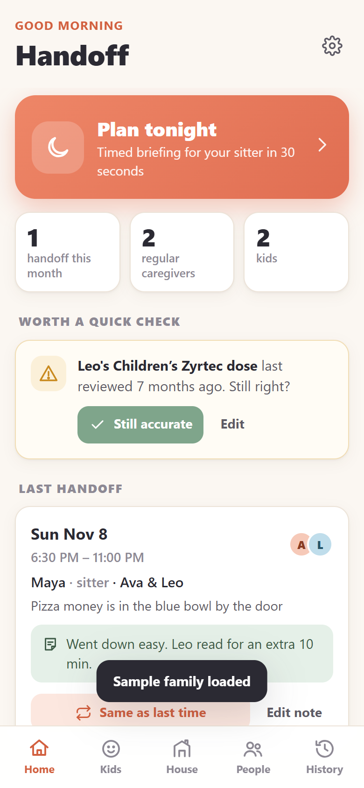
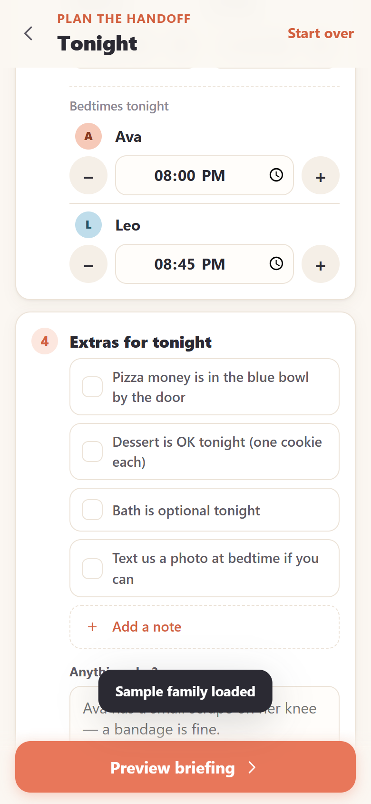
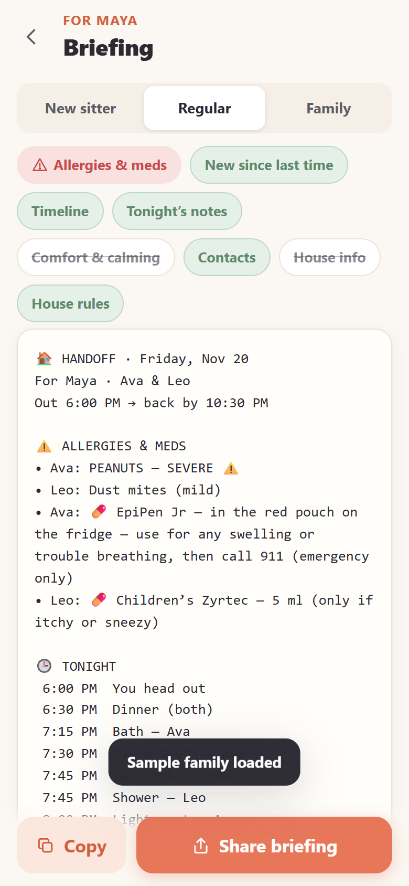
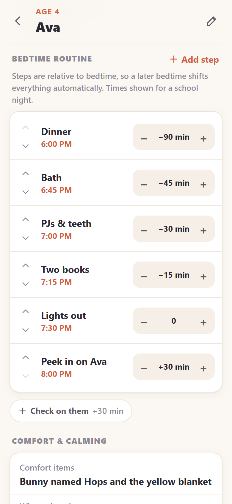
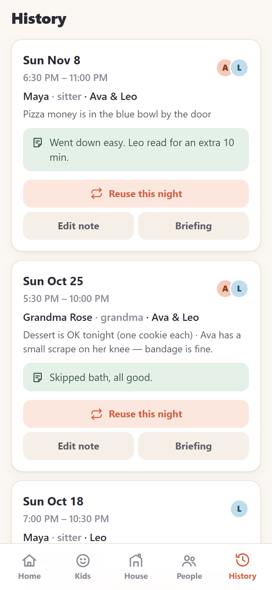
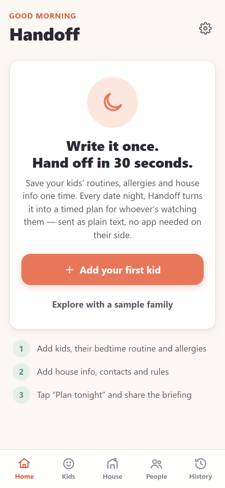

# Handoff

**Write your house info once and send any babysitter or grandparent a timed plan for tonight in 30 seconds.**

## The problem

Every date night, parents retype the same babysitter note: bedtime routine, allergies, emergency numbers, Wi-Fi, screen rules. Then they add the parts that change each night: who's coming, which kids are home, when you'll be back. The usual fix is a static template. A template can't adapt to tonight, and it can't turn "bath at 7, lights out at 7:45" into real clock times. The apps that do exist are mostly cloud apps that make the sitter create an account.

Evidence:
- [checklist.com babysitter checklist](https://checklist.com/babysitter-checklist): you remove what doesn't apply and save a copy, so parents keep starting the same note from scratch.
- [Nurture Life: what to leave the babysitter](https://www.nurturelife.com/blog/information-leave-babysitter-checklist/): the same sections come up every time (allergies, medications, a bedtime routine with times).
- [State Farm: prepare your babysitter for emergencies](https://www.statefarm.com/simple-insights/family/prepare-your-babysitter-for-emergencies): recommends an emergency info card that parents have to keep current.
- [Michigan Medicine (Mott) babysitter info guide (PDF)](https://www.med.umich.edu/mott/pdf/babysitter-info-guide.pdf): a children's hospital publishes a fill-in PDF that has to be refilled by hand.
- [Laszlo Apps babysitter app](https://sites.google.com/view/laszloapps/laszloappshome/babysitter-app): existing apps confirm the demand, but they need accounts and don't build a timed plan for tonight.
- [Family info tracker discussion](https://www.moritzfinedesigns.com/?p=12386): commenters want to share kids' info with grandparents and keep it current without being asked again and again.

Handoff is a private, offline builder. It turns info you saved once into a clean plain-text briefing for tonight that you can send through any messaging app.

## Features

- **Household profile, entered once.** Kids (age, bedtimes for school nights and weekends, allergies with mild/severe levels, medications with dose notes, comfort items, what calms them), emergency contacts you can reorder and tap to copy, house info (address, Wi-Fi, door code, urgent care, pets) and house rules.
- **Relative routines.** Each step is an offset from bedtime ("Bath −45 min"), set with a 5-minute stepper. If bedtime moves later, every step moves with it.
- **Tonight builder.** Pick the caregiver, tick the kids who are home, then set leave and back-by times and any per-kid bedtime changes. Toggle tonight's extras ("pizza money is in the blue bowl"). A merged timeline sorts every kid's steps by time and labels each one with the kid's avatar. It shows a warning if back-by is earlier than leave time, with an "after midnight" option.
- **Briefings by audience.** New sitters get everything, Regular caregivers get the timeline, contacts, rules and recent changes, and Family get the timeline and notes. You can switch individual sections on or off. Allergies and meds always come first, and severe allergies are written in capitals with a ⚠️.
- **One-tap share.** Share goes through the native Android share sheet. In a browser it copies to the clipboard instead. Every sent briefing is saved to History, and the caregiver's visit count goes up.
- **What changed.** Every field records when it was last edited. Returning caregivers get a "New since last time" section (for example "New Wi-Fi password" or "Ava: now allergic to cashews"). A caregiver getting their first briefing doesn't get one.
- **Staleness check.** Home lists anything you haven't reviewed in 3, 6 or 12 months (you choose). Each item has a one-tap "Still accurate" button.
- **Night log.** History lists past handoffs with after-notes ("went down easy"). "Reuse this night" fills in tonight's plan from a past night.
- **Your data stays yours.** Everything is stored on the phone. You can export and import all data as JSON, switch between a 12- and 24-hour clock, and reset everything (with a confirmation step). You can also load a sample family to try the app.

## Screenshots

| Home | Tonight's timeline | Briefing |
|---|---|---|
|  |  |  |

| Routine editor | History | First run |
|---|---|---|
|  |  |  |

## Install

Download `app-release.apk` from this repository's **GitHub Releases** page and open it on your Android phone. You may need to allow installs from unknown sources.

## Tech notes

- Plain HTML, CSS and JavaScript, with no frameworks, CDNs or network requests. The app runs from `file:///android_asset/www/` inside a thin Android WebView shell.
- `core.js` holds the state, persistence (`localStorage` key `handoff.v1`), time math, timeline merging, change diffing, staleness checks and the briefing text builder. `app.js` handles screens, bottom sheets, dialogs and navigation. `styles.css` holds the theme.
- It uses the optional native bridge when it's there: `Android.share`, `Android.vibrate`, and the hardware back button via `window.onAndroidBack` (closes sheets and dialogs first, then goes back a screen).
- Mobile-first layout for about 390px wide and still works at 360px. Touch targets are at least 44px, it respects safe areas, and it uses system fonts.
- QA: `_qa/scenario.js` steps through the main flows (adding kids, routine math, time validation, allergy placement, share and log, what-changed, reuse) with Playwright.

Built autonomously by the Auto Builder agent swarm (Claude Code).
